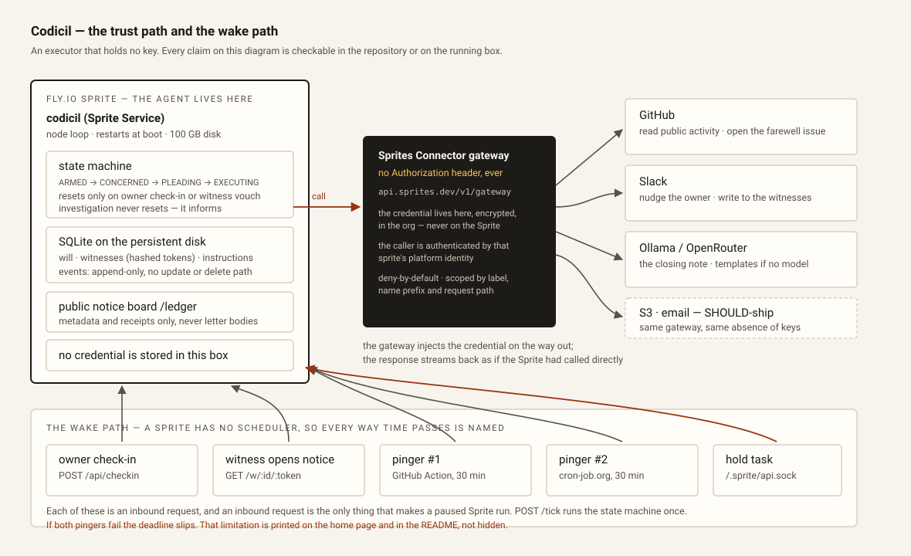

# Codicil

An agent that lives on a Fly.io Sprite and, if its owner goes silent past their own
deadline, carries out the owner's written instructions through the owner's real
accounts — **without ever holding a key**.

> clawds.ai resurrects *your agent* when it dies. Codicil executes *your will* through
> *your accounts* when *you* go silent, and never holds a credential.

Built for [Fly.io Hacksgiving 2026](https://fly.io/hacksgiving/). A Sprite and at least
one Sprites Connector are load-bearing here, not decoration: the credential never enters
the box, so an executor that can post, message and release files cannot leak a token even
if it is compromised.

<!-- LIVE LINK, VIDEO AND "TRY IT IN 60 SECONDS" LAND HERE AT SUBMISSION -->

## What it does

Codicil holds one document: your will. Not a legal instrument — the plain-language thing
you would want said, and the handful of actions you want taken, if you stop answering.

1. **Armed.** You check in. A streak counter on the public page is real days of operation.
2. **Concerned.** You miss your deadline. It nudges you on Slack.
3. **Pleading.** Still silent. It writes to your witnesses — people you named — and asks
   what they know. Their reply is the only thing that stands the clock down, short of you.
4. **Executing.** Past the final grace, it does what the document says: a farewell issue on
   your repo, a message in your channel, a file released from object storage. Each action is
   written to an append-only public notice board with its result reference.

Everything either phase does is on `/ledger`. Nothing on that page is a letter body.



The two paths that matter: **the trust path** (every outward call crosses Fly's connector
gateway, which holds the credential) and **the wake path** (a Sprite has no scheduler, so every
way time can pass is named).

## Evidence you can re-run

The repository ships the probes rather than a claim that probing happened:

```
scripts/probe-wake.sh inside     # P0/P1: node+sqlite, disk persistence, boot counter, task hold
scripts/probe-wake.sh outside <url>   # P1b: wake-on-request latency, measured from outside
scripts/probe-connectors.sh --write   # P2: gateway catalogue, then a real issue + Slack message
scripts/probe-llm.sh             # P3: the exact model path the gateway exposes
scripts/demo-driver.sh           # the whole ladder, ARMED -> EXECUTED, in one run
```


## Honest engineering notes

**There is no scheduler on a Sprite.** It pauses about 30 seconds after activity stops and
wakes only on an inbound HTTP request, or while a Task holds it (one hour maximum, renewed
by heartbeat). So "the agent notices you are gone" is only true if something wakes it. This
deployment names its wake sources, plainly, on the home page:

- each check-in and each witness visit is an inbound request and wakes it;
- a scheduled GitHub Action pings `POST /tick` every 30 minutes;
- a second, independent external pinger hits the same route (different failure domain).

If both pingers die, the deadline slips — the page says so rather than implying vigilance
the system cannot have.

**Secrets.** No provider credential ever enters the Sprite. Connector requests go to
`https://api.sprites.dev/v1/gateway/...` with no Authorization header; Fly injects the
credential at the gateway. `/proof` shows the environment variable *names* and the granted
scopes, never values.

## Layout

```
src/      types state evaluator executor connectors mind wake ledger server + pages/
public/   style.css, favicon.svg
test/     node:test suites
scripts/  probes, demo driver, streak check-in
docs/     the one architecture diagram
```

Run locally: `node --experimental-sqlite --experimental-strip-types src/server.ts`
Test: `npm test` · Type-check: `npm run typecheck`

## Day 0 platform facts

Established from Fly's documentation before any product code was written. They are listed here
in full because they are what the design rests on — not because a design document says so.

- **No scheduler.** Pause ~30s after activity; wake only on inbound HTTP or a held Task
  (max 1h, heartbeat-renewed via `/.sprite/api.sock`). Designs that "notice" something on a
  clock must name a wake source.
- **Connectors are deny-by-default.** Credentials live in the org and are injected at
  `https://api.sprites.dev/v1/gateway/<connector>/<path>`; the Sprite never holds the token.
  GitHub OAuth takes `scopes=repo,read:org`, with an `add_scopes` flow to widen later.
- **Egress is unrestricted by default**; a DNS allowlist policy is opt-in from outside and
  read-only inside (`/.sprite/policy/network.json`).
- **Disk persists, memory does not.** 8 vCPU, 100 GB ext4 (TRIM-billed), `auto-` checkpoints
  after ~1h of activity and on idle; a Service restarts at boot, a hand-started process does
  not survive a cold wake.
- **Inbound is one always-on HTTPS URL** per Sprite (`https://<name>-<org>.sprites.app/`),
  private by default; `--url-auth public` opens it.

## Sponsor integration — where the code is

The claim is "this executor never holds a key". These are the lines that make it true or false,
so a judge does not have to take the README's word for it. Line numbers are as of this commit;
function names are stable if they drift.

- **No credential in the box, ever** — the deliberate absence of an `Authorization` header at
  `src/connectors.ts:28`, with the reason above `gatewayCall()` at `src/connectors.ts:32`;
  gateway base at `src/connectors.ts:8`.
- **Connector discovery + granted scopes** — `listConnectors()` `src/connectors.ts:63`.
- **The two real writes** — `githubCreateIssue()` `src/connectors.ts:118`,
  `slackPostMessage()` `src/connectors.ts:126`.
- **The model beat** — `llmChat()` `src/connectors.ts:138`, with a template fallback that needs
  no model at all.
- **The nudge** — `sendNudge()` `src/executor.ts:60`; **execution, retry and receipts** —
  `executeWill()` `src/executor.ts:84`; idempotency lock at `src/executor.ts:27`.
- **The wake path** — management socket `src/wake.ts:35`, task hold `hold()` `src/wake.ts:52`,
  evaluator-on-every-request `onWake()` `src/wake.ts:68`.
- **The state machine** — `evaluate()` `src/evaluator.ts:46`, owner reset `applyCheckIn()`
  `src/evaluator.ts:94`, witness reset `applyVouch()` `src/evaluator.ts:122`, re-arm
  `applyWillSigned()` `src/evaluator.ts:137`.
- **Append-only ledger and token handling** — events table `src/state.ts:14`,
  `hashToken()` `src/state.ts:44`, constant-time `tokenMatches()` `src/state.ts:49`.
- **Routes** — `/tick` `src/server.ts:234`, `/proof` `src/server.ts:280`,
  `/api/checkin` `src/server.ts:320`, witness links rendered once `src/server.ts:355`.

Path scoping is set at consent time in the Fly dashboard, not in this repository: GitHub
allowlisted to the owner's own paths, Slack to `chat.postMessage` only — and Fly's connectors
refuse every Sprite until a policy grants access, which is what deny-by-default means here.

## Economics (why long custody is plausible at all)

Published Sprites rates (fact: fly.io/sprites/): CPU $0.0385/vCPU-hour and RAM $0.021875/GB-hour
**while active**, storage ≈ $0.50/GB-month and TRIM-billed, and **compute is unbilled while a
Sprite is paused**. A will is a few kilobytes and a sleeping Sprite costs nothing but its
storage, so a will idle 99.9% of the year costs pennies — which is the whole reason an executor
can plausibly outlive its owner's attention span. What this entry cannot promise is twenty years
of custody; it demonstrates the architecture and the economics that make such a promise credible.

## Security model

- **No provider credential is ever present.** It lives encrypted at the organisation level and is
  injected at the gateway per call.
- **Owner and witness tokens** are random, stored only as SHA-256 hashes, and compared in
  constant time (`src/state.ts:44`, `src/state.ts:49`). Witness links are rendered once at
  sealing and cannot be reconstructed afterwards; losing one means re-signing the will.
- **The URL is public by necessity** — you must be able to check in from anywhere. The
  compensating control is route-level tokens: everything that mutates state requires one.
- **The ledger is append-only**, with no update or delete path in the codebase.
- **No third-party send paths exist.** The only destinations are the owner's own connected
  accounts, and the only contact with another person is a witness notice the owner configured.
- **No money moves.** Payments are deliberately out of scope: a per-purchase approval cannot be
  given by someone who is gone, so the product does not pretend to spend.

## Built at the event, what was reused, and AI assistance

- **Built inside the window.** The repository opens at commit `c3bc3ab` (Nov 24, inside the
  Hacksgiving week) and every source file was written after it.
- **Reused:** the Node standard library and `node:sqlite` — zero third-party runtime
  dependencies — plus Fly's Sprites platform and connector gateway. No prior project was ported;
  this is net-new code.
- **AI assistance, stated plainly:** the build was driven by Hermes Agent, which ran the
  competition research, wrote the product spec and the build plan, and wrote the implementation.
  The check on that is not a claim but the suite: 25 tests covering every transition, the reset
  rules, token handling, the no-`Authorization`-header property and retry bounds, plus the demo
  run whose transcript ships with the entry.

## Status

Core loop green locally — 25/25 tests and a full `ARMED → EXECUTED` walk verified. Deployment to
a Sprite is the remaining step; the live link at the top is added the moment it exists, and not
before.

## Licence

MIT
